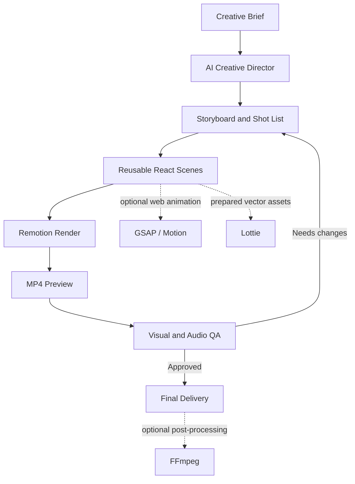

<div align="center">

# ✦ RISHEH Motion Studio

### From a rough idea to a production-ready motion piece.

**An AI-assisted motion design and video production workspace for Claude Code.**

Build product teasers, brand films, motion graphics, social videos, explainers, and repeatable video systems with code-first creative tooling.

<br/>

[](https://www.remotion.dev/)
[](https://www.typescriptlang.org/)
[](https://docs.anthropic.com/en/docs/claude-code/overview)
[](https://ffmpeg.org/)

<br/>

**Creative direction · Motion systems · Deterministic rendering · Quality checks**

</div>

---

> [!NOTE]
> **Project status: starter foundation.** This repository is being shaped into a reusable production system. The initial composition and workflow scaffolding are included; dependency installation, rendering, and automated media QA must be run in a real environment before treating a build as verified.

## The idea

Motion design workflows are often scattered across prompts, one-off scripts, animation libraries, render tools, and undocumented creative decisions. **RISHEH Motion Studio** brings those responsibilities into one understandable source of truth.

Instead of blindly copying a collection of repositories, this project gives each tool a clear job:

- **Claude Code** helps plan and implement the work.
- **Remotion** is the default engine for frame-accurate, data-driven video.
- **GSAP** is available for complex animation timelines where it adds value.
- **Motion** supports web and interface motion patterns.
- **Lottie** plays prepared vector animations; it is not a full video renderer.
- **FFmpeg** can handle post-processing, muxing, transcoding, and media inspection.

The goal is not “one prompt magically makes a perfect video.” The goal is a **repeatable pipeline** with explicit creative decisions, reusable scenes, inspectable source code, and a reviewable final render.

## ✦ What this workspace is designed for

<table>
<tr>
<td width="50%">

### 🎬 Product & brand videos
- Product launch teasers
- Service explainers
- Brand films and showreels
- Feature announcements

</td>
<td width="50%">

### 📱 Social-first content
- Vertical 9:16 clips
- Square 1:1 campaigns
- Short-form typography motion
- Reusable campaign variants

</td>
</tr>
<tr>
<td>

### 🧩 Motion systems
- Reusable scenes and transitions
- Brand tokens and layout rules
- Parameterized video compositions
- Data-driven creative templates

</td>
<td>

### 🛠️ Production workflow
- Brief-to-storyboard workflow
- Preview-first rendering
- Output validation hooks
- Documented tool selection

</td>
</tr>
</table>

## 🏗️ Architecture



### Design principles

1. **One default renderer.** Use Remotion as the primary video pipeline; avoid competing render architectures without a concrete need.
2. **Scenes are components.** Keep each scene reusable, typed, and easy to test or replace.
3. **Timing is explicit.** Define duration, FPS, transitions, and safe areas instead of relying on arbitrary browser timing.
4. **Preview before final.** Render a small review version and inspect it before producing the delivery master.
5. **Truthful creative.** Never invent product metrics, customer logos, testimonials, product capabilities, or factual claims.
6. **License-aware.** Verify the license and terms of every dependency, repository, font, music track, and asset before commercial use.

## 🚀 Quick start

### Requirements

- Node.js LTS compatible with the installed Remotion version
- npm
- A supported browser/runtime for Remotion rendering
- FFmpeg on your PATH for optional media post-processing and inspection
- Claude Code is optional; the project can be developed without it

### Install

```bash
git clone https://github.com/mahamirmh/RISHEH-Motion-Studio.git
cd RISHEH-Motion-Studio
npm install
```

### Open the composition studio

```bash
npm run studio
```

### Render the sample composition

```bash
npm run render
```

Expected output path:

```text
out/risheh-motion-studio.mp4
```

### Run the basic output check

```bash
npm run validate
npm run check:tools
```

> [!IMPORTANT]
> The validation command currently checks that the output file exists and is not suspiciously small. It is **not** a substitute for frame-by-frame visual review, audio listening, or full FFprobe inspection. Do not claim a render passed until the commands have actually been run.

## 🤖 Use it with Claude Code

Open the repository in Claude Code. The project instructions live in `CLAUDE.md`, and the focused workflow is in `.claude/skills/motion-video/SKILL.md`.

Example request:

> Create a 20-second launch teaser for the product described in `brief/creative-brief.md`. Start with a storyboard, state assumptions explicitly, use reusable Remotion scenes, render a preview, inspect the output, and report any checks you could not perform.

The workflow should move through these stages:

- [ ] Read the brief and identify missing facts or assets.
- [ ] Write a scene-by-scene storyboard and timing plan.
- [ ] Implement reusable scenes and brand tokens.
- [ ] Render a preview and review typography, pacing, transitions, and safe margins.
- [ ] Fix observed issues and render the delivery file.
- [ ] Run output checks and report verified facts and limitations.

## 🗂️ Repository map

```text
.
├── .claude/
│   └── skills/
│       └── motion-video/
│           └── SKILL.md       # Claude Code production workflow
├── brief/
│   ├── creative-brief.md      # Project facts, audience, format, assets
│   └── storyboard.md          # Scene-by-scene production plan
├── docs/
│   ├── architecture.md        # Runtime roles and design decisions
│   └── source-inventory.md    # Candidate repositories and adoption policy
├── public/                    # Local, licensed media assets
├── scripts/
│   └── validate-output.mjs    # Basic output-file check
├── src/
│   ├── scenes/
│   │   └── RishehIntro.tsx    # Starter motion composition
│   ├── Root.tsx               # Remotion composition registry
│   ├── index.ts               # Entry point
│   └── theme.ts               # Brand and motion tokens
├── .gitignore
├── CLAUDE.md
├── package.json
└── tsconfig.json
```

## 🎨 Creative workflow

| Stage | Input | Output | Review focus |
|---|---|---|---|
| Brief | Goal, audience, product facts | Creative direction | Is the message grounded and clear? |
| Storyboard | Approved direction | Scene list and timings | Does each scene move the story forward? |
| Design | Brand system and assets | Typography, palette, composition | Contrast, hierarchy, safe areas |
| Animation | Scenes and timings | Motion and transitions | Rhythm, easing, readability |
| Rendering | Composition and assets | Preview MP4 | Duration, frame consistency, missing assets |
| QA | Rendered media | Fix list and final export | Visual defects, audio, encoding, end frame |

## 🧰 Tooling strategy

| Tool | Responsibility | Use when |
|---|---|---|
| [Remotion](https://github.com/remotion-dev/remotion) | Primary programmatic video renderer | You need frame-accurate React-based video |
| [Remotion Skills](https://github.com/remotion-dev/skills) | Agent guidance for Remotion workflows | An AI coding agent needs documented rendering patterns |
| [GSAP](https://github.com/greensock/GSAP) | Sequencing and advanced web animation | A timeline needs detailed control beyond simple interpolation |
| [Motion](https://github.com/motiondivision/motion) | UI and web animation | Motion belongs in an interactive interface or web experience |
| [Lottie Web](https://github.com/airbnb/lottie-web) | Playback of existing Lottie JSON | A suitable prepared vector animation is available |
| [FFmpeg](https://ffmpeg.org/) | Media processing and inspection | You need muxing, transcoding, trimming, or technical checks |
| HyperFrames and community skills | Candidates to evaluate | A verified capability is missing from the core workflow |

**Do not install every candidate by default.** First verify its canonical source, maintenance status, license, setup requirements, and whether it overlaps with an existing tool. See [Source inventory](docs/source-inventory.md).

## 🧩 Integrated motion source system

The 20 original sources are now mapped in [`docs/source-integration-matrix.json`](docs/source-integration-matrix.json). The project uses **capability integration**, not a blind copy of 20 overlapping repositories.

### Project-local Claude Code skills

| Skill | Responsibility |
|---|---|
| `motion-director` | Brief → concept → storyboard and shot list |
| `motion-design-principles` | Timing, easing, composition, typography and accessibility |
| `product-launch-film` | Product teasers, launch films, feature proof and CTA |
| `beat-sync-audio` | Audio timing, beat map, narration and sound QA |
| `remotion-production` | React scenes, frame timing and Remotion rendering |
| `hyperframes-production` | Isolated HTML/GSAP/SVG/Canvas video projects |
| `web-motion` | Motion/GSAP interface animations |
| `lottie-assets` | Existing Lottie JSON playback and fallback strategy |
| `motion-graphics-shortform` | Vertical shorts, B-roll and aspect-ratio-specific layout |
| `motion-quality-gate` | Technical, visual, audio and factual review |

Claude Code discovers these project-level instructions under `.claude/skills/`. They are original integration skills informed by the capabilities of the listed tools; third-party repositories have not been copied wholesale.

### Two separate rendering paths

- **Remotion (default):** React-based, frame-accurate video. Use `npm run studio` and `npm run render`.
- **HyperFrames (optional):** HTML-native video with GSAP/SVG/Canvas. It has its own project format and stays isolated under `videos/hyperframes-demo/`.

To initialize the optional HyperFrames example workspace:

```bash
npm install
npm run setup:hyperframes
```

This command creates a separate example project and leaves the Remotion root untouched. Check the installed HyperFrames CLI help if its options change.

To inspect local tool availability:

```bash
npm run check:tools
```

### Optional upstream skill refresh

The local skills above are already versioned with this repository. To add upstream-maintained skills alongside them, use the official installation instructions for [Remotion Skills](https://github.com/remotion-dev/skills) and [HyperFrames](https://github.com/heygen-com/hyperframes). Review the resulting skill files for overlap before committing them. We intentionally do not auto-copy every third-party repository because the list contains overlapping engines, sample kits, and discovery catalogs.

### Integration coverage and honest status

- Runtime dependencies now include Remotion, GSAP, Motion, Lottie Web, and HyperFrames.
- Ten project-local skills cover creative direction, motion craft, launch films, audio, both render paths, web motion, Lottie, short-form, and QA.
- The integration matrix records all 20 original sources, their intended roles, and how they map into this workspace.
- All 20 entries now have a canonical source URL or an explicit framework/library URL in the integration matrix. Upstream source code is not copied wholesale; each capability is mapped to a local skill or runtime dependency, and direct imports remain subject to license/API review.
- Dependency installation, CLI initialization, and actual renders still need to be run in an environment with Node.js, browser dependencies, and FFmpeg. Adding a dependency to `package.json` does not mean it has already been installed or tested.

See [Source Integration Policy](docs/integration-policy.md) and [Source Integration Matrix](docs/source-integration-matrix.json).

## 📐 Output formats

The starter composition is configured for **1920 × 1080 at 30 FPS**. Adapt composition layout intentionally for other aspect ratios.

| Format | Canvas | Typical use |
|---|---:|---|
| Landscape | 1920 × 1080 (16:9) | Website, YouTube, presentations |
| Vertical | 1080 × 1920 (9:16) | Reels, Shorts, TikTok |
| Square | 1080 × 1080 (1:1) | Feeds and campaign assets |

These are recommended presets, not all implemented compositions yet.

## 🌍 Persian / RTL support

For Persian-language videos:

- Set text direction and alignment explicitly.
- Use a font with a valid license and ensure it is installed in the render environment.
- Check Persian shaping, joining, punctuation, numerals, and mixed Persian/English lines in the actual rendered frames.
- Avoid relying on browser defaults for RTL layout.
- Keep important copy inside platform-safe margins.

## 🧪 Quality gates

Before calling a video final, review:

- [ ] Correct duration, frame rate, dimensions, and codec
- [ ] No missing images, fonts, or other assets
- [ ] No clipped text or content outside safe margins
- [ ] No accidental black frames, flicker, or abrupt cuts
- [ ] Motion timing feels intentional and readable
- [ ] Audio is synchronized and has no clipping (if audio is present)
- [ ] Final frame and CTA have enough hold time
- [ ] All assets and music have documented usage rights
- [ ] Final file plays correctly outside the development environment

## 🔐 Security and licensing

- Never commit API keys, access tokens, or private client assets.
- Keep secrets in environment variables and local secret stores.
- Review third-party licenses before commercial use.
- **Remotion has specific licensing terms for company use.** Review its current [license documentation](https://www.remotion.dev/license) before using it in a commercial workflow.
- Do not redistribute third-party skills or source code without checking their terms.

## 🗺️ Roadmap

- [x] Establish a single default rendering path
- [x] Add a starter Remotion composition
- [x] Add project-specific Claude Code workflow instructions
- [x] Document tool responsibilities and adoption policy
- [ ] Install dependencies and verify a clean build
- [ ] Render and inspect a real preview
- [ ] Add reusable title, product reveal, feature, and CTA scenes
- [ ] Add vertical and square composition variants
- [ ] Add robust FFprobe-based media validation
- [ ] Add audio, captions, and licensed asset workflow
- [ ] Add automated render QA and CI
- [ ] Evaluate a separate 3D pipeline with Blender or Three.js when needed

## 📚 References

- [Remotion documentation](https://www.remotion.dev/docs)
- [Remotion rendering guide](https://www.remotion.dev/docs/render) — official rendering options and CLI workflow
- [Remotion Skills](https://github.com/remotion-dev/skills)
- [GSAP documentation](https://gsap.com/docs/v3/)
- [Motion documentation](https://motion.dev/)
- [Lottie Web](https://github.com/airbnb/lottie-web)
- [FFmpeg documentation](https://ffmpeg.org/documentation.html)

## Contributing

Keep pull requests focused, include reproduction steps for bugs, and document any new rendering path or dependency. New tools should solve a defined gap rather than duplicate an existing responsibility.

---

<div align="center">

**Designed as a maintainable creative system by RISHEH.**

*Make the idea clear. Make the motion intentional. Make the output reproducible.*

</div>
