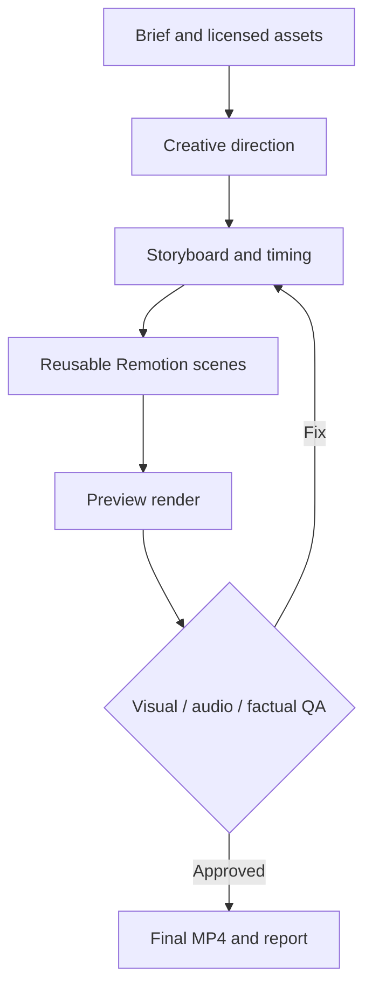

# 🤖 راهنمای استفاده از RISHEH Motion Studio با هوش مصنوعی

> **AI Operator Guide · فارسی · ۲۰۲۶-۱۰-۱۷**  
> این راهنما برای Claude Code، Codex، Cursor، GitHub Copilot و سایر ایجنت‌های کدنویسی که به فایل‌های ریپو و ترمینال دسترسی دارند نوشته شده است.

## ۱. این ریپو دقیقاً چیست؟

**RISHEH Motion Studio** یک محیط تولید موشن و ویدئوی کدنویسی‌محور است. ایجنت هوش مصنوعی Brief را می‌خواند، استوری‌بورد می‌نویسد، کامپوننت‌های React/Remotion می‌سازد، پیش‌نمایش می‌گیرد، خروجی MP4 رندر می‌کند و کیفیت را بررسی می‌کند.

**وضعیت واقعی:** ساختار و Skillهای محلی و اسکریپت‌ها در ریپو موجودند؛ نصب وابستگی‌ها، موفقیت build، راه‌اندازی HyperFrames و رندر نهایی در محیط اجرایی هنوز به‌طور مستقل تأیید نشده‌اند. وجود یک وابستگی در package.json به معنی نصب موفق آن نیست.

## ۲. شروع سریع در ترمینال

نیازمندی: Node.js 22+، npm و برای برخی کارهای رسانه‌ای FFmpeg/FFprobe؛ ابزار رندر ممکن است به مرورگر و وابستگی‌های سیستم نیاز داشته باشد.

```bash
git clone https://github.com/mahamirmh/RISHEH-Motion-Studio.git
cd RISHEH-Motion-Studio
npm install
npm run check:tools
npm run typecheck
npm run studio
```

برای رندر نمونه، در یک ترمینال دیگر یا پس از بستن Studio:

```bash
npm run render
npm run validate
```

فایل مورد انتظار: `out/risheh-motion-studio.mp4`. اگر دستور خطا داد، خروجی واقعی خطا را بررسی کنید؛ به‌جای ادعای موفقیت، علت را گزارش کنید.

## ۳. اتصال به AI coding agent

| ابزار | روش استفاده | نکته |
|---|---|---|
| **Claude Code** | ترمینال را در ریشهٔ ریپو باز کنید، `claude` را اجرا کنید و `CLAUDE.md` و `.claude/skills/` را بخوانید | Skillهای محلی برای Claude Code آماده شده‌اند؛ کشف خودکار به نسخه/محیط وابسته است |
| **OpenAI Codex** | ریپو را در محیط Codex باز کنید؛ از ایجنت بخواهید ابتدا `AGENTS.md` را بخواند | `AGENTS.md` راهنمای عمومی و سازگار با Codex است |
| **Cursor** | پوشهٔ پروژه را باز کنید و راهنمای `AGENTS.md` را به agent بدهید | قواعد و پشتیبانی از فایل‌های دستورالعمل ممکن است بین نسخه‌ها متفاوت باشد |
| **GitHub Copilot** | ریپو را در VS Code یا محیط دارای Copilot باز کنید و دستور دهید `AGENTS.md` را مطالعه کند | دسترسی به ترمینال/فایل را بررسی کنید |
| **ChatGPT معمولی** | لینک ریپو یا فایل‌های آن را به گفتگو بدهید | بدون محیط اجرای کد، صرفاً می‌تواند طرح، کد و بازبینی تولید کند؛ رندر MP4 تضمین نمی‌شود |

### پرامپت استاندارد برای همه ایجنت‌ها

```text
You are the production agent for RISHEH Motion Studio.
Read AGENTS.md, CLAUDE.md, brief/creative-brief.md, docs/AI-USAGE-GUIDE.fa.md,
and docs/source-integration-matrix.json before changing code.
Use Remotion as the default renderer.
First produce a timed storyboard in brief/storyboard.md.
Implement reusable scenes without inventing product claims or assets.
Run npm run typecheck, render a preview, and run npm run validate when the environment permits.
Report actual commands, errors, final output path, FPS, resolution, and unverified checks.
Do not silently install upstream repos or add a second renderer.
```

### نمونه پرامپت فارسی

```text
برای برند RISHEH یک ویدئوی معرفی ۱۵ ثانیه‌ای با فرمت ۹:۱۶ طراحی کن.
لحن مینیمال، پریمیوم و تایپوگرافیک باشد.
رنگ‌های برند #174A3A، #12304A و سفید هستند.
ابتدا استوری‌بورد با زمان‌بندی دقیق بده، سپس صحنه‌های Remotion را بساز.
فارسی/RTL و فاصله امن ریلز را رعایت کن.
اگر فونت راوی در پروژه موجود نیست، آن را جعل یا دانلود نکن؛ از من فایل مجاز بخواه.
بعد از ساخت، typecheck، پیش‌نمایش، رندر و QA را در صورت امکان انجام بده.
موارد اجرا نشده را صریح بنویس.
```

## ۴. گردش‌کار استاندارد



- **Brief:** هدف، مخاطب، نسبت تصویر، طول، متن تأییدشده، لوگو، فونت، صدا و منابع را در `brief/creative-brief.md` ثبت کنید.
- **Storyboard:** سناریو، duration هر سکانس، ترنزیشن، تایپوگرافی و audio cue در `brief/storyboard.md` قرار گیرد.
- **Implementation:** از کامپوننت‌های موجود در `src/` استفاده و صحنه‌های جدید را جداگانه بسازید.
- **Preview / Render:** `npm run studio` برای بازبینی و `npm run render` برای خروجی نمونه؛ در صورت نیاز composition جدید را در `src/Root.tsx` ثبت کنید و فرمان رندر را مطابق ID آن تنظیم کنید.
- **QA:** `npm run typecheck`، `npm run validate` و بررسی دستی خوانایی فارسی، تصاویر، صدا، کات‌ها و حقوق استفاده.

## ۵. Skillهای واقعاً موجود در پروژه

این ۱۰ مورد **Skillهای محلی نوشته‌شده برای این ریپو** هستند، نه کپی نصب‌شدهٔ تمام ریپوهای upstream:

| Skill | وظیفه |
|---|---|
| `motion-director` | سناریو، direction، shot list |
| `motion-design-principles` | ریتم، تایپوگرافی، easing، ترکیب‌بندی |
| `product-launch-film` | تیزر معرفی محصول و CTA |
| `beat-sync-audio` | هماهنگی صدا، نریشن و beat map |
| `remotion-production` | کامپوننت‌ها و رندر Remotion |
| `hyperframes-production` | مسیر جداگانه HyperFrames |
| `web-motion` | انیمیشن وب با Motion/GSAP |
| `lottie-assets` | کار با JSONهای Lottie |
| `motion-graphics-shortform` | ریلز، شورت و فرمت‌های عمودی |
| `motion-quality-gate` | کنترل کیفیت فنی و بصری |

مسیر: `.claude/skills/<skill-name>/SKILL.md`. برای ایجنت‌هایی که این ساختار را خودکار نمی‌خوانند، فایل Skill مرتبط را صریحاً به آن‌ها معرفی کنید.

## ۶. فهرست ۲۰ منبع و نوع ادغام

**مهم:** «ادغام قابلیت» با «نصب مستقیم سورس upstream» یکی نیست. جدول زیر وضعیت ثبت‌شده در `docs/source-integration-matrix.json` را به زبان عملی توضیح می‌دهد. هیچ‌کدام از ۲۰ مخزن upstream صرفاً به‌خاطر حضور در این جدول، clone یا vendored محسوب نمی‌شوند.

| # | منبع | نقش در RISHEH | وضعیت ادغام |
|---:|---|---|---|
| 1 | [claude-motion](https://github.com/whaleyxbt/claude-motion) | workflow فیلم و صدا | قابلیت در Skillهای محلی؛ upstream نصب نشده |
| 2 | [claude-motion-design](https://github.com/howseen-ai/claude-motion-design) | رندر HTML/Playwright | راهنمای مسیر جایگزین؛ upstream نصب نشده |
| 3 | [motion-graphics-skills](https://github.com/charlie947/motion-graphics-skills) | موشن کوتاه | نگاشت به Skillهای محلی |
| 4 | [claude-remotion-skill](https://github.com/cmak34/claude-remotion-skill) | Remotion skill | نگاشت محلی؛ اصالت تطبیق با لینک اولیه نیازمند بازبینی |
| 5 | [klik-anim-skill-creation](https://github.com/t3knobox/klik-anim-skill-creation) | اصول انیمیشن/دوربین | نگاشت محلی؛ upstream نصب نشده |
| 6 | [hyperframes-motion-reel-skill](https://github.com/Sunwood-ai-labs/hyperframes-motion-reel-skill) | شو‌ریل beat-sync | نگاشت محلی |
| 7 | [product-launch-motion](https://github.com/AbubakrChan/product-launch-motion) | ویدئوی لانچ | نگاشت محلی |
| 8 | [animate](https://github.com/cth9191/animate) | استوری‌بورد/انیمیشن | نگاشت محلی |
| 9 | [motion-design-skills](https://github.com/iart-ai/motion-design-skills) | مبانی دیزاین موشن | نگاشت محلی |
| 10 | [hyperframes-student-kit](https://github.com/nateherkai/hyperframes-student-kit) | مثال‌های HyperFrames | مرجع؛ مثال‌ها نصب نشده‌اند |
| 11 | [HyperFrames](https://github.com/heygen-com/hyperframes) | موتور HTML-to-video | dependency تعریف‌شده + setup اختیاری؛ اجرا تأیید نشده |
| 12 | [Remotion](https://github.com/remotion-dev/remotion) | موتور اصلی ویدئو | dependency + composition پروژه |
| 13 | [Remotion Skills](https://github.com/remotion-dev/skills) | الگوهای رسمی ایجنت | نگاشت محلی؛ upstream مستقیم نصب نشده |
| 14 | [GSAP](https://github.com/greensock/GSAP) | انیمیشن timeline | dependency تعریف‌شده |
| 15 | [motion-design](https://github.com/cth9191/motion-design) | الگوهای طراحی موشن | نگاشت محلی؛ تطبیق منبع اولیه نیازمند بازبینی |
| 16 | [awesome-motion-skills](https://github.com/iart-ai/awesome-motion-skills) | فهرست منابع | فقط reference catalog |
| 17 | [motion-graphics-skill](https://github.com/cskwork/motion-graphics-skill) | ویدئوهای کوتاه محصول | نگاشت محلی |
| 18 | [motion-dev-animations-skill](https://github.com/199-biotechnologies/motion-dev-animations-skill) | انیمیشن UI | نگاشت محلی |
| 19 | [Motion](https://github.com/motiondivision/motion) | انیمیشن React/Web | dependency تعریف‌شده |
| 20 | [lottie-web](https://github.com/airbnb/lottie-web) | اجرای Lottie JSON | dependency تعریف‌شده |

**تعریف وضعیت‌ها:**  
- **dependency تعریف‌شده:** در `package.json` وجود دارد؛ نصب/تست موفق باید جداگانه انجام شود.
- **نگاشت محلی:** اصول و نقش منبع در Skill اختصاصی پروژه پوشش داده شده است؛ کد upstream به پروژه منتقل نشده است.
- **مرجع:** صرفاً برای یادگیری، ارزیابی یا انتخاب ابزار است.
- **setup اختیاری:** اسکریپت وجود دارد ولی اجرای موفق آن تأیید نشده است.

منبع ماشین‌خوان و مرجع نگاشت: [source-integration-matrix.json](source-integration-matrix.json). سیاست حقوقی و فنی: [integration-policy.md](integration-policy.md).

## ۷. انتخاب موتور مناسب

| نیاز | ابزار پیشنهادی |
|---|---|
| ویدئوی تبلیغاتی و خروجی MP4 | **Remotion** (پیش‌فرض) |
| HTML/SVG/Canvas video | **HyperFrames** در پروژهٔ جداگانه |
| انیمیشن رابط وب | **Motion** یا **GSAP** |
| نمایش انیمیشن JSON آماده | **Lottie Web** |
| پردازش و بررسی فایل رسانه‌ای | **FFmpeg / FFprobe** در صورت نصب |

برای ساخت workspace جداگانه HyperFrames:

```bash
npm run setup:hyperframes
```

این اسکریپت به CLI خارجی و شبکه نیاز دارد و ممکن است با تغییر نسخهٔ CLI نیازمند اصلاح باشد؛ آن را موفقِ تست‌شده فرض نکنید.

## ۸. خروجی قابل قبول از هر ایجنت

در پایان هر مأموریت، AI باید **مسیر فایل‌های تغییرکرده، ترکیب‌بندی، duration، FPS، رزولوشن، فرمان‌های واقعاً اجراشده، وضعیت typecheck/render/validate، محدودیت‌های محیط و لینک/مسیر خروجی** را گزارش کند. اگر امکان رندر ندارد، صریح بگوید «کد آماده شده ولی MP4 تأیید نشده است».

**اصل اجرایی:** ابتدا یک ویدئوی ۱۰ تا ۱۵ ثانیه‌ای واقعی را end-to-end بسازید؛ سپس تولید انبوه، قالب‌های مشتریان و automation را اضافه کنید.
